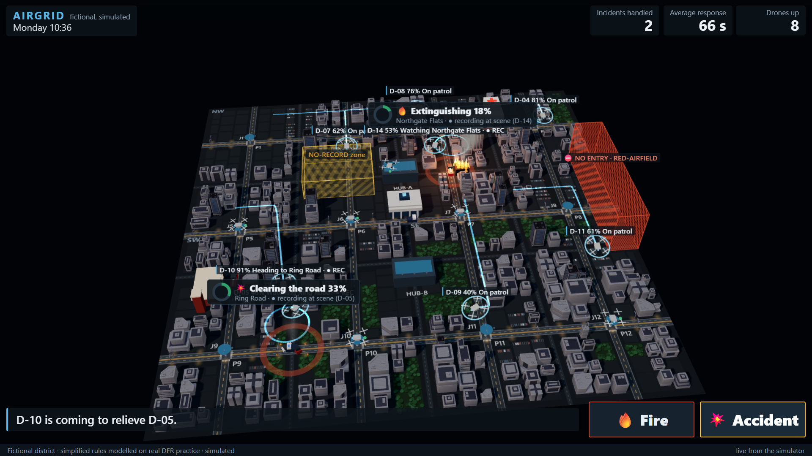
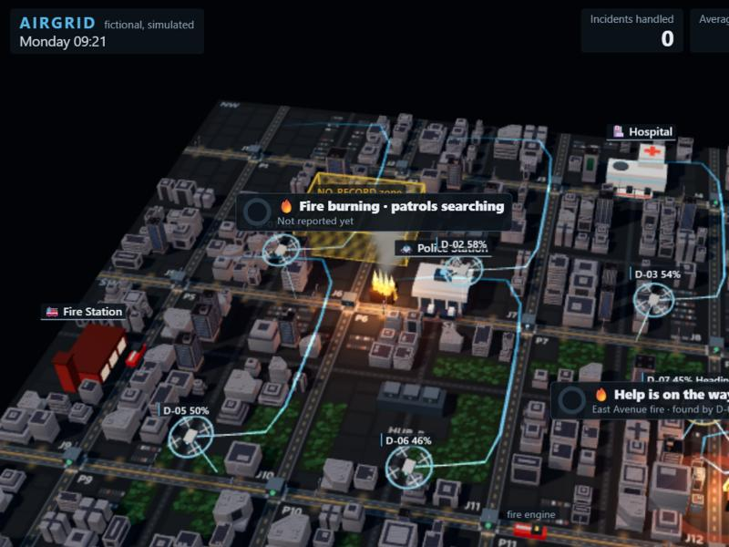
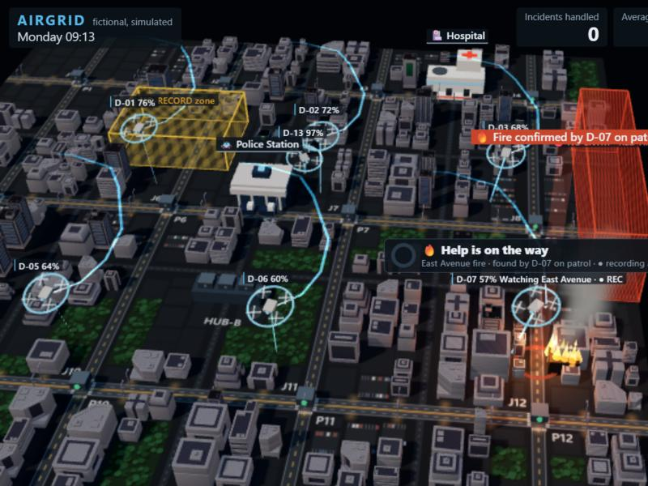
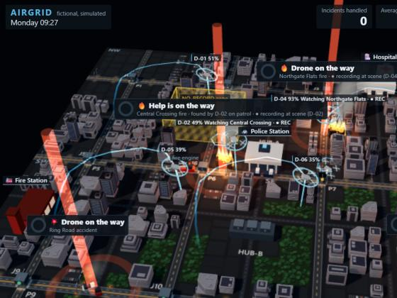
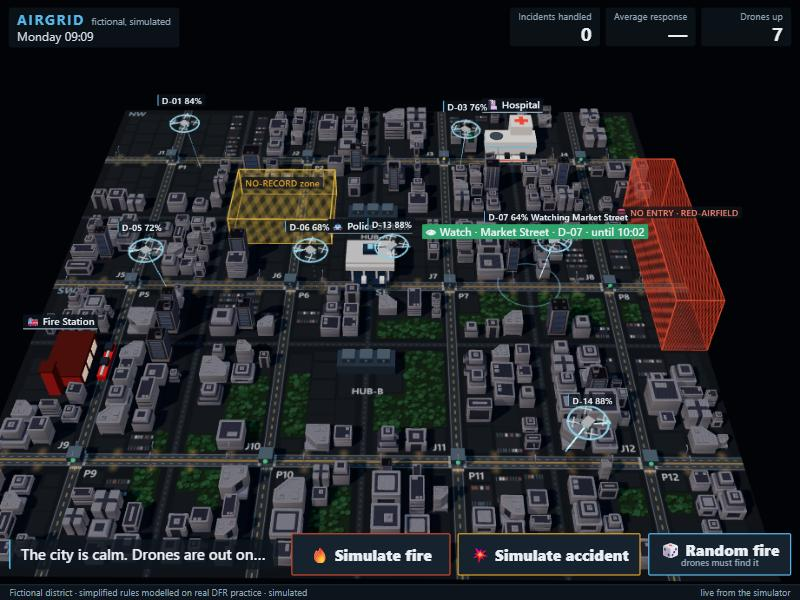
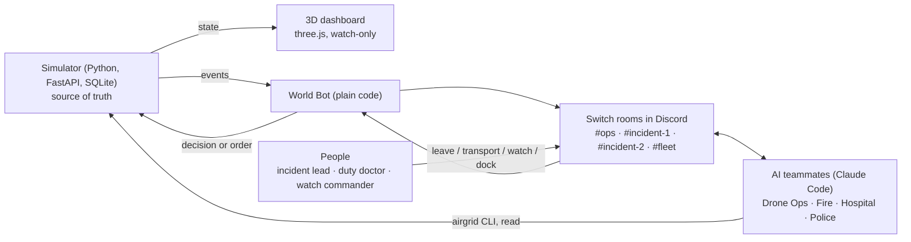

# AirGrid

**A city drone monitoring system with AI agents, run from one team chat on Switch.** Drones patrol a fictional city. Drone Ops, Fire, Hospital and Police are your teammates in Discord: AI agents in Switch rooms who each own a job, tag each other for help, and check with a person before any big call.

Built for **Flip the Switch** (Nov 4–7, 2026), Best Business Workflow track. 📄 **[Demo guide (PDF)](docs/AirGrid-Demo-Guide.pdf)**: everything below, with more screenshots.

> **Simulated.** AirGrid is a training and prototyping simulator. The district, the agency and every number on screen are simulated. No real drones, no real dispatch, no identification of people. The "thermal sensor" is simulated too.



**Contents:** [The idea](#the-idea) · [Who's who](#whos-who) · [The dashboard](#the-dashboard) · [Discord commands](#discord-commands) · [What each channel looks like](#what-each-channel-looks-like) · [Try it](#try-it) · [Rules the system enforces](#rules-the-system-enforces) · [Run it](#run-it) · [How it's built](#how-its-built) · [Build and commit timeline](#build-and-commit-timeline)

## The idea
Cities already send drones first to emergency calls. Chula Vista's programme has flown more than 25,000 calls, with the drone first on scene in about 97 seconds on average, and Shenzhen runs drones from docks above its streets. The drones aren't the hard part. Coordination is: fire, police and medical teams each hold part of the picture, decisions get made by phone, and afterwards nobody can show who decided what.

AirGrid puts that coordination in one team chat. The AI teammates do the legwork and hand off to each other in the open, the people make the calls, and the record writes itself.

## Who's who
### Channels (Switch rooms on Discord)
| Channel | What happens there | Who's in it |
|---|---|---|
| `#ops` | Information only for incidents: one line when one starts, and the final report. Also where the Watch Commander types fleet orders (`watch`, `dock`, `release`) | World Bot, Drone Ops, you |
| `#incident-1`, `#incident-2` | One incident each. The teammates hand work to each other by @mention, and every decision for a person is asked here: the doctor's `transport` / `treat` and the lead's `leave` / `stay`. A second incident at the same time gets the other room | World Bot, all four agents, you |
| `#fleet` | The whole fleet, live: every drone change about every 10 s, a fleet board every 2 minutes, an alert when a patrol drone goes home with no spare, and every order you gave. No @mentions, no replies | World Bot only |
| `#test-room` | A quick check before a demo: `@dispatch reply with one word: ready` | World Bot, agents, you |

### The team
The agents work like teammates in the chat: each owns one job, answers when it's tagged, hands off to the next teammate, and asks a person when a decision is needed. All four are Claude Code, run by Switch Console on the laptop, each in its own folder with only its instructions and a token.

| Member | Kind | Job |
|---|---|---|
| **Drone Ops** (`@dispatch`) | AI teammate | Reports what the drones see, tags the right service, escorts the ambulance, relays requests. Answers "what's happening?" from the simulator |
| **Fire Station** (`@fire-station`) | AI teammate | Acknowledges fires and sends engines |
| **Hospital** (`@hospital`) | AI teammate | Sends ambulances and recommends treating on scene or taking the patient in |
| **Police** (`@police`) | AI teammate | Checks scenes for injuries, clears junctions and traffic jams |
| **World Bot** (`@airgrid-worldbot`) | Plain code, no AI | A registered Switch client. Carries simulator events into the rooms and people's decisions back. The only member that can change the simulation, and only for a mapped person |

### People and their roles
Roles live in `config/humans.yaml`. Each person is matched by their Switch sender id, so changing a display name can't fake a role. Solo, one person holds every role; with a team, give each role to someone different.

| Role | Decides |
|---|---|
| **Incident lead** | `leave` or `stay`: whether the drone can leave a scene that looks clear |
| **Duty doctor** | `transport` or `treat`: take the injured to the Hospital, or treat on scene |
| **Watch commander** | Fleet orders: `watch` an area, `dock` or `release` a drone |

**The principle behind all of it: agents propose, people decide, the simulator enforces.** No agent can approve its own work, and time-critical work (launches, battery relief, landing slots, no-fly rules) is simulator code, so the city keeps running even if every agent goes offline.

## The dashboard
Open the URL that `scripts/run_game.sh --discord` prints. It includes a one-time operator key, so don't share it. The dashboard is **watch-only** for the drone monitor team: decisions are made in Discord, and the only inputs are three simulate buttons.

| Button | What happens |
|---|---|
| **🔥 Simulate fire** | A reported fire at a city scene. The nearest drone diverts and the Fire Station responds |
| **💥 Simulate accident** | A reported crash. Police check for injuries; with injuries, an ambulance goes and the doctor decides |
| **🎲 Random fire** | A fire nobody reported. It burns on the map, and a patrol drone has to find it with its simulated thermal sensor. One at a time; the button says "searching…" until it's found |

What you see: 14 drones patrolling, each with its battery and job · Fire Station, Hospital and Police Station, with vehicles that drive on the roads · progress rings at scenes ("Extinguishing 64%") · a red no-entry airfield and a no-record zone · counters for incidents handled, average response and drones up.

| | |
|---|---|
|  |  |
| **Random fire:** burning, no alert beacon, "patrols searching". Agents and Discord know nothing yet | **Found:** a patrol drone confirms it, and the normal fire response starts |
|  |  |
| **Busy city:** each label says its stage and who found it | **`watch market`:** the ring over Market Street and the drone "Watching Market Street" |

## Discord commands
Type them as a whole message, with no @mention. Upper or lower case both work. The World Bot answers in the same room; anything that isn't a command is just chat.

### Decisions on an incident (in the incident's room)
| Type | Who | What happens |
|---|---|---|
| `transport` | Duty doctor | The ambulance takes the patient to the Hospital, with a drone escorting it |
| `treat` | Duty doctor | The crew treats on scene; no transport |
| `leave` | Incident lead | The scene looks clear: the drone returns to patrol and the report is written |
| `stay` · `stay 2 more minutes` | Incident lead | The drone keeps watching, then asks again with a clearer reading. The sim sets the hold time |
| `leave market` · `stay ring` | Incident lead | With two calls open, add the place's first word to say which one |

### Fleet orders (in `#ops`)
| Type | Who | What happens |
|---|---|---|
| `watch market` | Watch commander | The nearest spare patrol drone flies loops over Market Street for 60 clock-minutes (about 2 real minutes). No recording: it isn't an incident. If its battery runs low, another drone takes over |
| `watch ring road 30 min` · `increase surveillance on north road for 45 minutes` | Watch commander | The same, for a set time (5 to 120 clock-minutes) |
| `stop watching market` | Watch commander | Ends the watch; the drone goes back on patrol |
| `dock D-4` | Watch commander | The drone flies to the nearest free dock and stays grounded, for a fault report or to charge before a busy hour. Refused while it's at an incident or escorting |
| `release D-4` | Watch commander | The drone can fly again once charged |

Places: Central Crossing, East Avenue, Market Street, Mill Lane shops, North Road, Northgate Flats, Ring Road, South Depot; any unique part of the name works (`market`, `mill`). Drones: D-01 to D-14 (`D-4` and `d04` both work). The 3 drones kept ready for emergencies are never used for a watch.

### Ask the teammates (mention them)
| Type | What happens |
|---|---|
| `@dispatch what's happening?` | Drone Ops reads the simulator and answers in one line, numbers exactly as printed |
| `@dispatch ask police to stay until the tow arrives` | Drone Ops relays it to Police. Relaying changes nothing in the sim |

### Switch's own commands
| Type | What happens |
|---|---|
| `!list-documents` (in `#ops`) | Shows the room's documents, including the **Flight authorisation log** the World Bot writes, one entry per incident |
| `!list-agents` · `!agents-status` | Who's in the room and whether they're online |

## What each channel looks like
`#incident-2`, an accident from start to finish (wording follows the bot's templates; agent replies vary a little from run to run):
```text
airgrid-worldbot  💥 Ring Road accident: Drone Ops has eyes on. @police you're needed.
police            🚓 Police: on the way to Ring Road.
airgrid-worldbot  🚑 Ring Road accident: 3 injured, @hospital ambulance needed.
airgrid-worldbot  🚑 Ring Road accident: Hospital: 3 injured, condition needs the Hospital.
                     Recommend transport. @Aadarsh your call: `transport` or `treat`.
Aadarsh           transport
airgrid-worldbot  ✅ Ring Road accident: Duty Doctor confirms transport to the Hospital.
airgrid-worldbot  🛰 Ring Road accident: Drone Ops (D-03) escorting the ambulance, route clear.
airgrid-worldbot  🛰 Ring Road accident: Drone Ops (D-03) → @police ambulance stuck near North Road, please clear it.
police            🚓 Police: North Road, on it.
airgrid-worldbot  🚓 Ring Road accident: Police cleared the junction near North Road.
airgrid-worldbot  🚑 Ring Road accident: Hospital has the patient. Delivered.
airgrid-worldbot  🙋 @Aadarsh Ring Road accident looks clear. Reply: `leave` or `stay`.
Aadarsh           leave
airgrid-worldbot  ✅ Ring Road accident: heading back to patrol.
```

`#ops`, the headlines, an order and the report:
```text
airgrid-worldbot  💥 Ring Road accident. Crews are working in #incident-2.
Aadarsh           watch market
airgrid-worldbot  ✅ D-07 watches Market Street until 10:02 (no recording: not an incident).
airgrid-worldbot  ✅ Ring Road accident: closed. Report INC-2 (simulated)
                  Response: first eyes on in 84 s · Who went: police car, ambulance · Timeline: …
```

`#fleet`, the whole fleet live:
```text
🛰 Fleet: 7 in the air (4 on patrol, 3 at incidents) · 4 charging · 3 ready (kept for emergencies).
   Since 16:00: 14 went to charge, 13 took off. Lowest in the air: D-08 41%.
09:17 D-13 takes off for patrol (100%)
09:19 D-07 heads to dock P7 (44%)
09:22 D-07 lands at P7 and charges (40%)
09:36 D-06 charged at HUB-B, ready (80%)
📌 Fleet: D-02 heads to dock P3 and is grounded until released (92%).
⚠️ Fleet: D-14 heads to a dock at 35% from patrol route 5. No spare drone to relieve it: 3 stay ready for emergencies.
```

## Try it
**A · The accident, end to end.** Press **Simulate accident** and open its incident room. Drone Ops tags Police, Police call in the Hospital, the Hospital asks the doctor: type `transport`. A named drone flies ahead of the ambulance, spots a jam and asks Police to clear it. When the scene looks clear, type `leave`, and the report lands in `#ops`.

**B · Found before anyone called.** Press **Random fire**. Flames appear with no alert beacon. A patrol drone picks up the heat, turns to check, confirms it, and Drone Ops tells the Fire Station.

**C · Steering the fleet.** Watch `#fleet` scroll. In `#ops` type `watch market`: a drone peels off its patrol and a ring appears over Market Street. Type `dock D-4`: it flies home and shows "Grounded by operator". Then `release D-4`.

## Rules the system enforces
A refusal is the proof: the rules live in the simulator, not in an agent's good behaviour.

| Try this | What you'll see |
|---|---|
| Someone without the role types `leave` or `watch market` | `❌ REJECTED \| reason: FORBIDDEN_ROLE \| instead: needs incident_lead / watch_commander` |
| The doctor types `leave`, or the lead types `transport` | Refused: words only ever answer their own kind of call |
| `dock D-3` while D-3 is escorting the ambulance | `❌ REJECTED \| reason: DRONE_NOT_READY`: "D-03 is escorting an ambulance; it stays until that's done" |
| `watch market` when every patrol drone is low | Refused with `DRONE_NOT_READY`: no spare drone, and 3 stay ready for emergencies |
| `watch nowhere` | Refused with `NOT_FOUND`, listing the place names |
| `leave` with nothing open | "Nothing is waiting on you right now." |

Always true:
- The simulator alone owns the truth. Agents read and propose through the `airgrid` CLI; they never change state on their own.
- A 25% battery reserve, a red no-fly zone with no override, and a no-record zone are hard rules. Three charged drones always stay ready for emergencies.
- Recording happens only at an active incident scene, and it's logged; a watch never records. Face identification does not exist in the system.
- No AI model inside the simulator. Same scenario, seed and decisions give the same numbers, every run.

## Run it
Needs Python 3.12 with [uv](https://docs.astral.sh/uv/), and Git Bash on Windows.

```bash
uv sync
uv run pytest -q
scripts/run_game.sh
```

Open the printed URL (it includes a one-time key) and press a simulate button. The city runs without Discord; Discord is where the team works.

**With Switch and Discord:** `HUMAN_TODO.md` has the exact steps (*Phase 08* and *City mode*). In short: register the World Bot (`scripts/bootstrap_worldbot.py` on a local Switch server), create the four agents in Switch Console pointing at `~/airgrid-agents/<name>` (from `scripts/install_agents.sh`), invite them to `#ops`, `#incident-1` and `#incident-2`, invite only the World Bot to `#fleet`, paste the room instructions from `agents/switch/rooms/`, then run `scripts/run_game.sh --discord`.

| If this happens | Do this |
|---|---|
| Agents silent, or "My machine is offline" | Restart Switch Console, wait for the green dot, then `@dispatch reply with one word: ready` in `#test-room` |
| `#fleet` is empty | Invite only `@airgrid-worldbot` there, then restart `scripts/run_game.sh --discord`. The bot checks its rooms only at start |
| `transport` or `leave` gets no reply | Type it in the incident room from the mapped account |
| The page says "no valid key" | Use the exact URL the launcher printed; each run makes a new key |

The original full simulator, a three-hour scripted shift with seven desks and a golden timeline it reproduces exactly, is still here: `scripts/run_golden.sh FRIDAY-RUSH`, `scripts/run_demo.sh`. It's also on the `cv-full-version` branch.

## How it's built


**Why Switch:** the rooms are the operation. The teammates and the people work the same task in the same place, decisions sit with roles instead of one screen, and the fleet has its own room that pings nobody. Without Switch, this is a pile of separate scripts and a dashboard nobody can act from: no shared picture, no handoffs, no record of who decided.

| Path | What |
|---|---|
| `sim/` | Simulator: city mode, rules, approvals, privacy log, golden run |
| `dashboard/` | 3D city view (static HTML/JS) |
| `worldbot/` | World Bot: sim events to rooms, human decisions to the sim |
| `cli/` | `airgrid` CLI the agents use |
| `agents/` | Agent instruction files and room instructions |
| `world/`, `scenarios/` | The fictional district and scenarios |
| `tests/` | Simulator, integration and live agent tests |
| `docs/` | Specs, decision log (`DECISIONS.md`), demo guide and video script |

## Build and commit timeline

- **Before the hackathon (Oct 29 – Nov 1), my own tools:** the city simulator from my existing 3d world repo and its rules, the `airgrid` CLI, the 3D map, and the agent instructions and test harness. These are the existing tools and libraries used.
- **Also before the hackathon, while learning Switch:** a first version of the Switch integration, built in a private learning repo to understand how Switch works: the World Bot as a Switch client, the `#ops` and incident-room workflow, and the ambulance escort with the doctor's call and Police clearing traffic (Nov 1).
- **During the hackathon (Nov 4–7):** this repo, and everything committed from Nov 5 onward. The commits show what came in when:
  - **Random fire found on patrol:** a hidden fire that a roaming drone detects with its simulated thermal sensor, drawn burning on the map before it's found.
  - **Realtime `#fleet` on Discord:** every drone taking off, docking, charging and coming back, a fleet board every 2 minutes, and alerts when a route has no spare drone.
  - **Orders from Discord:** `watch <place>` to put a drone over an area, and `dock` / `release` to ground a drone, all checked by the simulator.
  - **Cleaner rooms:** every decision asked only in the incident's own room, `#ops` kept to headlines and reports, and the escort drone named in its lines.
  - The README, the [demo guide](docs/AirGrid-Demo-Guide.pdf), the demo video, and the live runs in Discord.

This repo's first commit holds the pre-hackathon tools without the Switch integration. The second brings the integration over from my learning repo, labelled as such. That history is private, but I'm happy to share it with the judges on request.


## Sources for the context above
- Chula Vista Police Department, Drone as First Responder programme reporting (calls flown, time to scene).
- DJI Dock 3 specifications (flight time, charge time, wind limit), used to calibrate the simulated drones.
- Builder's Notes reel on Shenzhen's street-side drone docks (footage: XuZhenqing), the inspiration for the project.

These are real programmes for context only. No real programme's numbers are presented as AirGrid's results.

## Credits
- City models: City Kit (Commercial) and City Kit (Roads) by [Kenney](https://kenney.nl), CC0.
- [three.js](https://threejs.org), MIT.
- Built with Claude Code.
