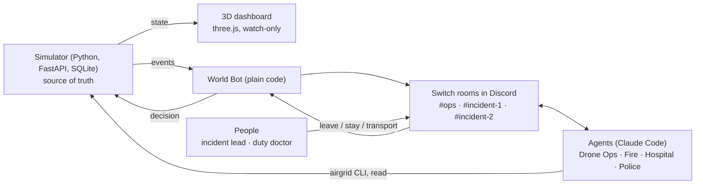

# AirGrid

**A city's drone response team, run from team chat.** Drones patrol a fictional district. When something goes wrong, AI agents for Drone Ops, Fire Station, Hospital and Police coordinate in Switch rooms, and the people on the team make the calls in the same chat.

Built for **Flip the Switch** (Nov 4–7, 2026), Best Business Workflow track.

> AirGrid is a training and prototyping simulator. The district, agency and every number on screen are simulated. No real drones, no real dispatch, no identification of people.


## What was built when
I want this to be clear, because the hackathon asks for the Switch workflow to be built during the event (Nov 4–7, 2026).

- **Before the hackathon (Oct 29 – Nov 1), my own tools:** the city simulator, its rules and privacy log, the `airgrid` CLI, the 3D map, and the agent instructions and test harness. These are the existing tools and libraries the rules allow.
- **Also before the hackathon, while learning Switch:** a first version of the Switch integration (the World Bot as a Switch client, the `#ops` and incident-room workflow, and the ambulance escort). I built it in a private learning repo to understand how Switch works.
- **During the hackathon (Nov 4–7):** this repo, the random-fire detection flow, the README and demo, the live runs in Discord, and everything committed from Nov 5 onward. The commits show what came in when.

This repo's first commit holds the pre-hackathon tools without the Switch integration. The second brings the integration over from my learning repo, labelled as such. That history is private, but I'm happy to share it with the judges on request.

## The problem
Cities already send drones first to emergency calls. Chula Vista's programme has flown more than 25,000 calls, with the drone first on scene in about 97 seconds on average. The hard part isn't flying; it's coordination. Fire, police and medical teams each hold part of the picture, decisions get made by phone, and afterwards nobody can show who decided what.

AirGrid puts that coordination in one team chat: the agents do the legwork, the people decide, and the record writes itself.

## What happens
1. Drones roam the city on patrol, always moving.
2. A fire or accident starts. Either it's reported (**Simulate fire**, **Simulate accident**) or a patrolling drone finds it with its simulated thermal sensor (**Random fire**).
3. The nearest drone gets eyes on and tells the right service in the incident room. Engines, police cars and ambulances drive there on the roads, and you can watch them on the map.
4. The agents hand off to each other in the open: Police check for injuries, Hospital recommends treating on scene or taking the patient in, Drone Ops escorts the ambulance and asks Police to clear a traffic jam.
5. **People decide in chat.** The duty doctor replies `transport` or `treat`. The incident lead replies `leave` or `stay` when the scene looks clear. Nothing waits on the dashboard.
6. A report lands in `#ops`: timeline, who went, response time, recording window, minutes saved.

## Why Switch
- **Rooms are the operation.** `#ops` shows the headlines and the reports. `#incident-1` and `#incident-2` hold each incident's work, so two emergencies stay readable.
- **Agents and people work the same task together.** Agents report, recommend and hand off by @mention; Switch delivers each one. The human answers in plain words.
- **Decisions sit with roles, not one screen.** The incident lead and the duty doctor are roles in `config/humans.yaml`. Solo, one person holds both; with a team, each person gets their own.
- **Without Switch** this is a pile of separate scripts and a dashboard nobody can act from: no shared picture, no handoffs, no record of who decided.

## How Switch is set up
**Agents connected** (all Claude Code, run by Switch Console on the laptop, each in its own folder with only its instructions and a token):

| Agent | Job in the room |
|---|---|
| `dispatch` (Drone Ops) | Reports what the drones see, tags the right service, escorts the ambulance, asks the people for decisions |
| `fire-station` | Acknowledges fires, sends engines, reports progress |
| `hospital` | Sends ambulances, recommends treating on scene or taking the patient in |
| `police` | Checks scenes for injuries, clears roads and traffic jams |
| `airgrid-worldbot` | Plain code, no AI. A registered Switch client that carries simulator events into the rooms and human decisions back |

**Channels** (Discord, through Switch's Discord bridge):

| Channel | What happens there |
|---|---|
| `#ops` | Information only: one line when an incident starts and the final report. Two messages per incident |
| `#incident-1`, `#incident-2` | One incident each: the agents' handoffs and every call for a person (the doctor's `transport`, the lead's `leave`). Two overlapping emergencies stay readable |

**People and roles** live in `config/humans.yaml`: the **incident lead** decides `leave` or `stay`, and the **duty doctor** decides `transport` or `treat`. Each person is matched by their Switch sender id, so a display name can't impersonate them. Solo, one person holds both roles; with a team, give each role to a different person.

**Setting it up yourself:** `HUMAN_TODO.md` has the exact steps. Register the World Bot (`scripts/bootstrap_worldbot.py` on a local Switch server), create the four agents in Switch Console pointing at `~/airgrid-agents/<name>` (from `scripts/install_agents.sh`), invite them to the three channels, paste the room instructions from `agents/switch/rooms/`, then run `scripts/run_game.sh --discord`.

## Rules the code enforces
- The simulator alone owns the truth. Agents read and propose through the `airgrid` CLI; they never change state on their own.
- Only mapped humans decide, and only in the room, via the World Bot.
- Timing, battery, landing slots, relief drones and no-fly zones are simulator code. An AI model never sits in the critical path, and the city keeps running if every agent goes offline.
- A 25% battery reserve, a red no-fly zone with no override, and a no-record zone are hard rules.
- Recording happens only at an active scene and is logged. Face identification does not exist in the system.
- No AI model inside the simulator. The "thermal sensor" is simulated and labelled as such.

## Architecture


## Run it
Needs Python 3.12 with [uv](https://docs.astral.sh/uv/), and Git Bash on Windows.

```bash
uv sync
uv run pytest -q
scripts/run_game.sh
```

Open the printed URL (it includes a one-time key) and press a simulate button. The city runs without Discord; Discord is where the team works.

**With Switch and Discord:** follow `HUMAN_TODO.md` (*Phase 08* and *City mode*), then run `scripts/run_game.sh --discord`.

The original full simulator, a three-hour scripted shift with seven desks and a golden timeline it reproduces exactly, is still here: `scripts/run_golden.sh FRIDAY-RUSH`, `scripts/run_demo.sh`. It's also on the `cv-full-version` branch.

## Repo map
| Path | What |
|---|---|
| `sim/` | Simulator: city mode, rules, approvals, privacy log, golden run |
| `dashboard/` | 3D city view (static HTML/JS) |
| `worldbot/` | World Bot: sim events to rooms, human decisions to the sim |
| `cli/` | `airgrid` CLI the agents use |
| `agents/` | Agent instruction files and room instructions |
| `world/`, `scenarios/` | The fictional district and scenarios |
| `tests/` | Simulator, integration and live agent tests |
| `docs/` | Specs and decision log (`DECISIONS.md`) |

## Sources for the context above
- Chula Vista Police Department, Drone as First Responder programme reporting (calls flown, time to scene).
- DJI Dock 3 specifications (flight time, charge time, wind limit), used to calibrate the simulated drones.

These are real programmes for context only. No real programme's numbers are presented as AirGrid's results.

## Credits
- City models: City Kit (Commercial) and City Kit (Roads) by [Kenney](https://kenney.nl), CC0.
- [three.js](https://threejs.org), MIT.
- Built with Claude Code.
