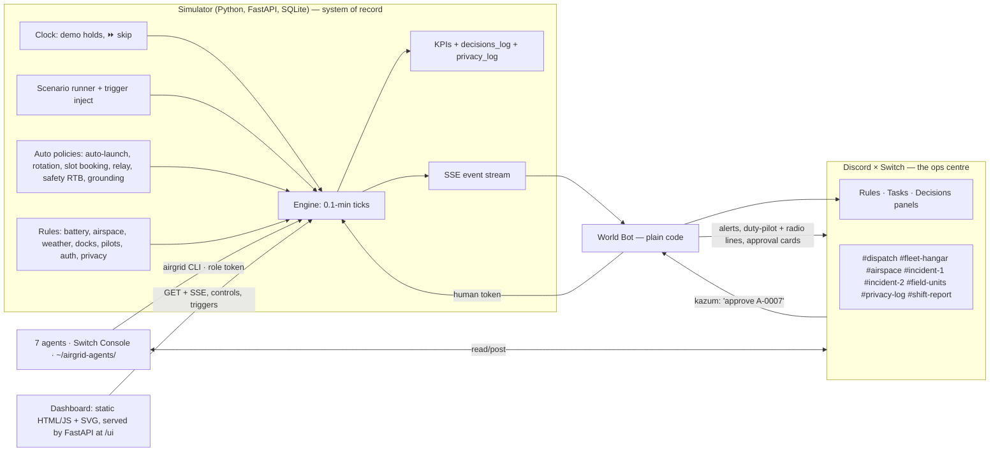

# 02 · Architecture

## Big picture


## Who decides what (the latency contract)
| Thing | Done by | Why |
|---|---|---|
| Launch nearest capable drone for accident / fire / flood | **sim policy** (standing approval at 17:00) | eyes-on in ~2 min can't wait for an LLM |
| Patrol rotation, backfill when a patrol drone is diverted | **sim policy** | arithmetic, every few minutes |
| Slot booking at RTB, DOCK_FULL/OFFLINE reroute | **sim policy** | must never leave a drone circling |
| Track relay inside an approved track | **sim policy** (Relay agent narrates, may propose changes) | battery projection, 0-gap |
| Safety RTB when projected landing ≤ reserve + 2 | **sim** | hard floor |
| Weather grounding | **sim** (Airspace agent announces) | measured number |
| Track, loudspeaker, footage release, temp zone, diverting a drone off an incident, out of service | **human approval** via World Bot | named, on record |
| Triage, SITREPs, routes with zones, refusals, unit tasking, advisories, shift report, proposing anything above | **agents** | judgement + talking to humans |

Agents never sit in the critical path of a launch. They explain, handle exceptions, and talk to the humans.

## Components
### 1. Simulator (`sim/`)
- FastAPI on `localhost:8740`, SQLite `data/airgrid.db` (WAL). Tick = 0.1 sim-min (6 sim-s), positions on a km grid, battery as float, displayed rounded.
- **Clock modes:** `demo` (0.5 sim-min per real s; **holds** while any approval with `hold_clock` is pending and for up to 45 real s after an event that an agent owns until that agent has posted; `⏩` skip to next event at 10 sim-min/s when nothing is pending), `live` (runs, holds on pending approvals), `headless` (as fast as possible).
- **Engine order per tick:** events → expiries/weather end → queued actions → auto policies → movement + battery → landings → invariants → KPIs → emit SSE diffs. Same order as `tools/fleet_check.py`.
- **Simulated people:** duty pilots DP-1/DP-2 (accept drones up to 4, post templated lines), ground units (Manhattan movement 0.5 km/min), CAD caller lines, suspect path from scenario. No LLM.
- **Baseline** (`sim/baseline.py`): same seed, patrol cars + one van drone team (setup 3 min, 40-min flight, 27-min charge).
- **Never served:** future events, suspect path ahead of now, baseline internals during a managed run. Grep-tested.

### 2. `airgrid` CLI (`cli/`)
Typer over httpx. Compact JSON default, `--text` for one line. Exit 0 ok, 2 rejected (JSON with `code`, `reason`, `hint`), 1 error. Role token per agent; no agent token can approve.

### 3. World Bot (`worldbot/`)
Plain Python. `RoomTransport` interface: `FakeRoom` (terminal, stdin approvals; for building and tests) and `SwitchRoom` (Switch custom client; confirm protocol with the docs MCP).
- Sim → rooms: event alerts, duty-pilot and ground-unit lines, approval cards.
- Rooms → sim: a mapped human typing `approve A-0007` / `reject A-0007 <reason>` → sim with that human's token. The only approval path.
- Decision sink → Switch Decisions (or manual fallback L14). Tasks for the patrol plan.
- Reports which agents are mid-reply so demo holds can release.

### 4. Runtime agents (`agents/<name>/` = templates)
Seven instruction files + `.env.example`. **At runtime they run from `~/airgrid-agents/<name>/`** (copied by `scripts/install_agents.sh`): instruction file, `.env`, nothing else. They cannot read the repo, the scenario file or the checker (L11).

### 5. Dashboard (`dashboard/`)
One static page (`index.html`, `app.js`, `style.css`) served by FastAPI at `/ui`. SVG map drawn from `/world` geometry (the sim's data, never hand-drawn coordinates), state from `/state` + SSE. Positions interpolated client-side between ticks for glide (display only). No business logic; coverage, ETAs, violations arrive computed. No framework, no build step. Started Oct 31 in a parallel lane.

## Run modes
| Mode | Clock | Events | Agents | Use |
|---|---|---|---|---|
| `demo` | holds + ⏩ | FRIDAY-RUSH seed | on | video, judging |
| `live` | runs, holds on pending | scenario + triggers | on | exploration |
| `golden` | headless | seed | off, scripted golden actions | tests; must equal the checker |
| `baseline` | headless | seed | off, baseline policy | scorecard |

## Machines
- **Solo (default):** sim + World Bot + dashboard + seven agents in one Switch Console on kazum's laptop.
- **Team (later):** host runs sim/World Bot/dashboard; teammates run agents in their Console pointing at `AIRGRID_API_URL` on the host (LAN or tunnel).

## Repo layout
```
airgrid/
├── CLAUDE.md  CONTEXT-HANDOFF.md  README-START-HERE.md  README.md (Phase 09)
├── docs/                 # this kit + golden-timeline.txt + PROGRESS.md
├── world/airgrid.yaml
├── scenarios/friday_rush.yaml  quiet_shift.yaml  triggers.yaml
├── tools/fleet_check.py  tools/validate_world.py
├── config/humans.yaml  roles.yaml  tokens.local.yaml (gitignored)
├── sim/  app.py clock.py world.py geo.py fleet.py docks.py pilots.py airspace.py weather.py
│         incidents.py suspect.py ground.py privacy.py policies.py actions.py rules.py
│         scenario.py kpi.py baseline.py golden.py db.py events.py
├── cli/airgrid.py
├── worldbot/ transport.py fake_room.py switch_room.py bot.py cards.py decisions_sink.py lines.py
├── agents/  dispatch fleet airspace intel relay privacy comms  (+ switch/ room templates, harness/)
├── dashboard/ index.html app.js map.js style.css
├── tests/  evals/  scripts/  runs/
```

## Design rules
1. The simulator owns state. 2. Every write validated; reason codes quoted verbatim. 3. Only humans approve, only via the World Bot. 4. One owner per event; others stay quiet unless @mentioned. 5. Same seed + same decisions → same numbers. 6. No LLM inside the sim. 7. Agents never see the future (events, suspect path) or the repo.
