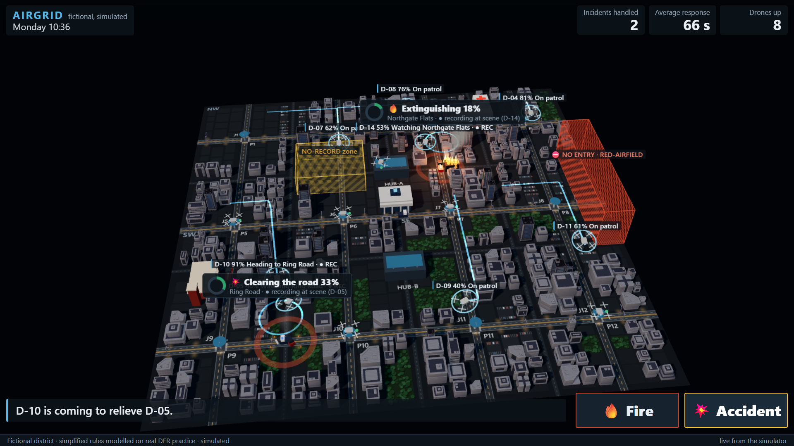
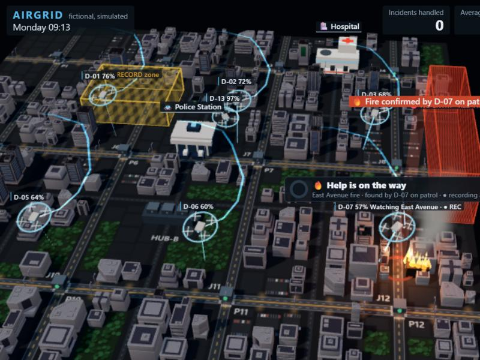
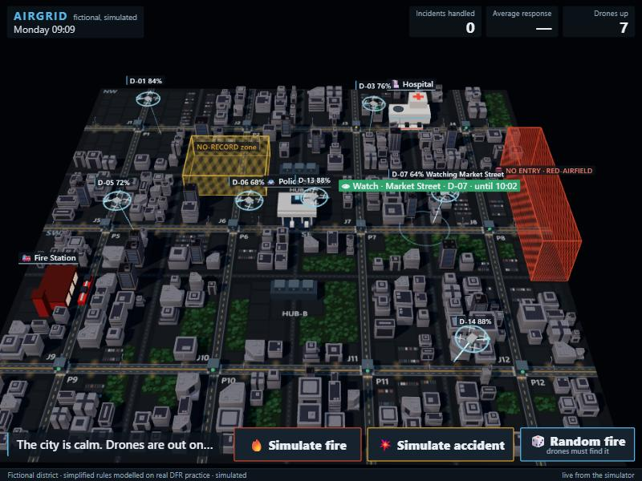

# I built a city's drone response team inside a Discord chat, using Switch

A while back I saw a reel about Shenzhen. The police there have drones sitting in docks on top of traffic lights. They fly out, watch traffic or an accident, come back, land on their own and recharge. An operator can send one out without going anywhere near the intersection.

The reel ended with "the real innovation isn't the drone, it's the network", and that stuck with me. Getting a drone into the sky fast is mostly solved. Chula Vista's drone programme has flown more than 25,000 calls and gets a drone on scene in about 97 seconds. The hard part is everything around it. Fire, police and the hospital each hold one piece of the picture, decisions happen over the phone, and afterwards nobody can show who decided what.

So for Flip the Switch I tried to build that coordination layer. It's called AirGrid: a city drone monitoring system with AI agents, run from one team chat.

Quick disclaimer before anything else: it's all simulated. A fictional city, simulated drones, no real dispatch, and nothing in it identifies people.

## The idea in one sentence

Drone Ops, Fire Station, Hospital and Police are AI teammates in Discord. Each one owns a job, tags the others when it needs help, and checks with a person before any big call.

That last part was the whole design for me. I didn't want an AI that runs a city. I wanted AI that does the legwork and hands the decisions to people, in a place where everyone can see who decided what.

## How it's put together

There are three pieces.

The first is a city simulator in Python (FastAPI and SQLite). It owns all the state: 14 drones on patrol routes, docks, batteries, no-fly zones, fire engines, ambulances and police cars driving on actual roads. There's no AI model inside it at all. It's deterministic, so the same scenario and the same decisions give the same numbers every run. A 3D dashboard in three.js shows the city live, and it's watch-only on purpose.

The second is four Claude Code agents, run by Switch Console on my laptop: `dispatch` (shown as Drone Ops), `fire-station`, `hospital` and `police`. Each lives in its own folder with only its instructions and a token, and the only way it can read the city is a small CLI. None of them can change anything in the simulation. They read, report, recommend and tag each other.

The third piece is what I'm most happy with. It's a World Bot that's plain code, no AI, registered as a custom Switch client. It carries events from the simulator into the rooms and carries people's decisions back. It's the only member of the chat that can change the simulation, and only for a mapped person. Roles live in a config file and get matched on the person's Switch sender id, so changing your Discord display name doesn't give you the doctor's role.

Switch is what ties it together. Every agent and every person is in the same Discord channels through Switch's Discord bridge, and an @mention is all it takes to hand work to someone.

## What a single accident looks like

I press "Simulate accident" on the dashboard. Here's what happens in the incident room after that:

1. Drone Ops says it has eyes on and tags `@police`. A police car leaves the station on the map.
2. Police find three people injured and tag `@hospital`. An ambulance heads out.
3. The Hospital recommends taking them in and tags the duty doctor. That's a person. I type `transport`.
4. A drone flies just ahead of the ambulance. It spots a traffic jam before the ambulance gets there, and Drone Ops asks `@police` to clear it. You can watch the police car show up and the cars move out of the way.
5. Patient delivered. Drone Ops asks if the drone can leave the scene. The incident lead types `leave`.
6. A report lands in `#ops`: who went, response time, the recording window, the full timeline.

There's also a "Random fire" button. It starts a fire that nobody reports. It burns on the map, and the agents and Discord know nothing about it until a patrol drone picks up the heat with its (simulated) thermal sensor, flies over to check and confirms it. Then the normal fire response kicks in.

## Steering the fleet from chat

Later I added orders the Watch Commander can type in `#ops`:

- `watch market` sends the nearest spare patrol drone to circle Market Street for a while. It never records, because it isn't an incident.
- `dock D-4` sends a drone home and keeps it grounded. You'd use that for a fault report, or to charge a few drones before a busy hour.
- `release D-4` lets it fly again.

The simulator checks every order before it happens. It always keeps three charged drones back for emergencies, so if the fleet is stretched it says no and tells you why. I like those refusals more than the features honestly, because they prove the rules live in the simulator and not in an agent behaving nicely.

There's also a `#fleet` channel that only the World Bot posts in. It shows every drone live: taking off, heading to a dock, charging, ready again, plus a fleet board every two minutes. It never pings anyone, so no agent wakes up for routine stuff.

## Things that went wrong

Most of what I learned came from running it live in Discord and watching it break.

### Too many pings
The first live run flooded `#ops`. Every update tagged someone, and it was unreadable. I split it up: `#ops` became info only (one line when an incident starts, one report at the end), and the actual work moved into `#incident-1` and `#incident-2`. A second incident at the same time gets the other room, so two emergencies stay readable.

### Decisions showing up in two places
For a while the `transport` and `leave` calls were posted in both `#ops` and the incident room. I'd answer in the incident room, and `#ops` still showed it as unread, like I'd ignored it. Now every decision is asked once, in the incident's own room.

### My own reply getting dropped
I had a 25-second timeout on the leave-or-stay call, borrowed from an earlier, more game-like version. Then a real `leave` from me arrived after the timeout and got thrown away. People in a chat are slower than a game loop, so I removed the timeout. The drone just keeps watching until someone answers.

### The registration key
The World Bot needs a registration key to join as a custom client. On a local server that Switch Console runs, there's no Gateway page to make one, so I had to create it through the API instead. It worked, but it took a while to figure out.

### "My machine is offline"
Once, the link between Switch Console and my laptop dropped, and every agent replied with that. Restarting Console fixed it. Now it's the first line of my troubleshooting list.

## Privacy, because the reel asked

The Shenzhen reel ends with a fair question: "Where do we draw the line between public safety and personal privacy?" I tried to answer it in the code instead of a slide:

- Drones record only at an active incident, and every recording window is logged.
- A watch over an area never records.
- Face identification doesn't exist in the system. If an agent asks for it, the request is refused and logged.
- No AI makes the big calls. People do, in the open, and the chat keeps the record.

## What I liked about Switch, and what I'd change

What worked: putting agents in a normal Discord channel and having them hand work to each other just by @mention. The agent protocol was clear enough that I could write my own client for the World Bot, and room instructions were an easy way to give every agent in a room the same rules.

What I'd want next:

- A way to make registration keys in Console for local servers.
- A choice to keep an agent's replies in its thread or in the channel. Right now each @mention opens a thread for the agent's activity while the message lands in the channel, which got confusing in busy rooms.
- Room documents you can read from Discord. The World Bot writes a "Flight authorisation log" document, one entry per incident, but in Discord I can only list it with `!list-documents`, not read it.

## Try it

The code is on GitHub: [github.com/Aadarsh805/airgrid-switch](https://github.com/Aadarsh805/airgrid-switch). The README has every command, the setup steps for Switch and Discord, and a PDF demo guide. The city runs on its own with `scripts/run_game.sh`, and Discord is where the team works.

To be upfront about timing: I built the simulator, the CLI and the 3D map before the hackathon, plus a first version of the Switch workflow while learning Switch. The README has a timeline of what came when. During the hackathon I added the random fire detection, the live `#fleet` channel, the orders from chat, cleaner rooms, and the demo video.

If I keep going, the next things are real teammates holding the roles (a friend as the duty doctor, someone else as the incident lead), a second fire engine call, and closing roads with a public advisory the police agent drafts and a person approves.
